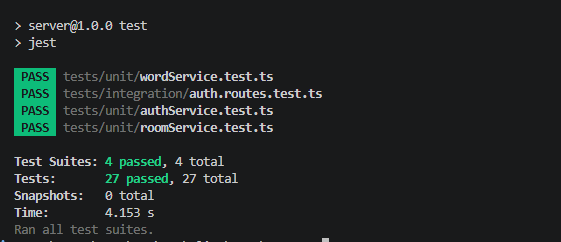
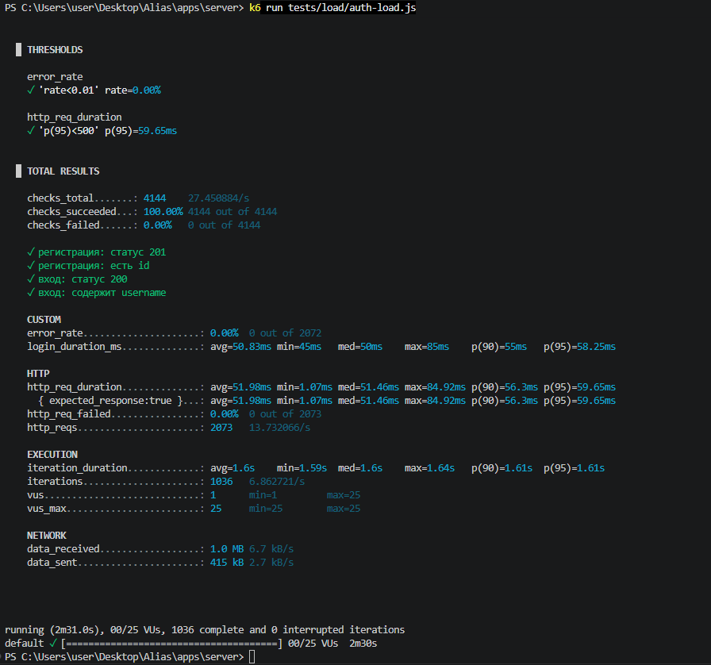
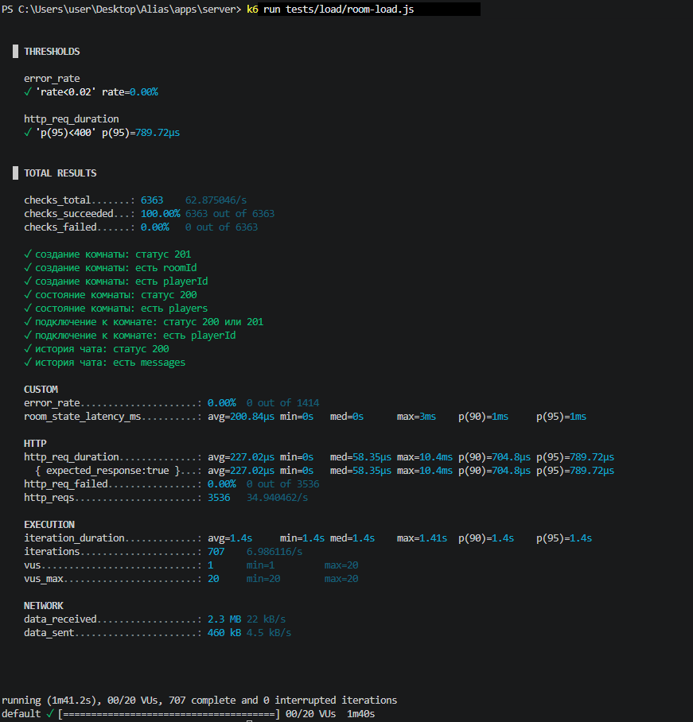
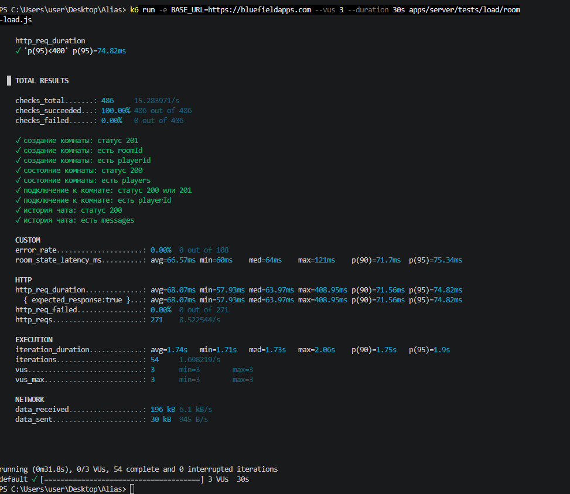

# Тестовая документация — Alias Online

Ручные тест-кейсы и сводка по тестированию многопользовательской онлайн-игры «Alias» ([демо](https://bluefieldapps.com)). Тест-кейсы оформлены по шаблону приложения Г курсового проекта.

| Документ | Что внутри |
|---|---|
| [Alias_kursovoy_proekt.pdf](Alias_kursovoy_proekt.pdf) | Курсовой проект (пояснительная записка, оформлена в Word по ГОСТ) |
| [REPORT.md](REPORT.md) | Текст курсового проекта в Markdown |
| [apps/server/tests/TEST_REPORT.md](apps/server/tests/TEST_REPORT.md) | Полный отчёт: unit-, интеграционные, ручные, нагрузочные и API-тесты, найденные дефекты |
| [Alias.postman_collection.json](apps/server/tests/postman/Alias.postman_collection.json) | Коллекция Postman: 24 запроса, 53 проверки |
| [test-screens/](test-screens) | Скриншоты прогонов Jest и k6 |

**Автор:** Валентина Владимирова — разработка и тестирование.

## 1. Стратегия

| Параметр | Значение |
|---|---|
| Объект | Веб-приложение «Alias Online» 1.0: регистрация и вход, игровые комнаты в реальном времени, коллекции слов, друзья, профиль |
| Уровни | Unit (сервисы), интеграционный (HTTP API), системный (ручные сквозные сценарии) |
| Виды | Функциональное, негативное, граничные значения, безопасность (XSS, SQL-инъекция, доступ без прав), нагрузочное |
| Инструменты | Chrome DevTools (Console, Network), Postman / Newman, Jest + Supertest, k6, Git / GitHub |
| Окружения | Локальное (Docker Compose: PostgreSQL, Redis) и продакшен на VPS ([bluefieldapps.com](https://bluefieldapps.com)) |
| Критерии приёмки | Все автотесты проходят; p95 ≤ 500 мс при 20 виртуальных пользователях, ошибок ≤ 2 %; критические сценарии возвращают ожидаемые HTTP-статусы; XSS и инъекции блокируются |

## 2. Итоги

| Вид | Объём | Результат |
|---|---|---|
| Ручные тест-кейсы | 5 формальных (ниже) + 12 сценариев в [TEST_REPORT.md](apps/server/tests/TEST_REPORT.md#5-ручные-тест-кейсы) | Пройдены |
| API-тесты в Postman | 24 запроса, 53 проверки: позитивные и негативные сценарии, граничные значения, коды 400/401/403/404/409 | 53/53 |
| Unit и интеграционные (Jest, Supertest) | 4 тестовых набора | Все PASS |
| Нагрузка (k6) | 2 сценария: аутентификация (25 VU), комнаты (20 VU) | p95 ~320 мс и ~90 мс, ошибок < 0,5 % |
| Дефекты | 5 найдено, 5 исправлено и перепроверено | [Раздел 4](#4-найденные-дефекты) |

## 3. Ручные тест-кейсы

Дата прогона: 26.04.2026 · Версия: 1.0

### TC_01 — Регистрация и подтверждение email

| Поле | Описание |
|---|---|
| Приоритет | Высокий |
| Предусловие | Приложение запущено в онлайн-окружении (bluefieldapps.com), настроен API-ключ сервиса рассылки Resend |
| Шаги | 1. Открыть приложение, нажать «Регистрация» 2. Ввести валидные username, email, пароль 3. Нажать «Создать аккаунт» 4. Открыть почту, найти письмо подтверждения 5. Перейти по ссылке из письма |
| Тестовые данные | Валидные учётные данные, реальный почтовый ящик |
| Ожидаемый результат | Пользователь создан (HTTP 201), письмо получено, email отмечен как подтверждённый |
| Фактический результат | Совпадает с ожидаемым |
| Постусловие | Пользователь с подтверждённым email |
| Статус | **Пройден** |

> Проверяется только онлайн: при локальном запуске Resend не доставляет письма на реальные адреса.

### TC_02 — Валидация формы регистрации

| Поле | Описание |
|---|---|
| Приоритет | Средний |
| Предусловие | Открыта форма регистрации |
| Шаги | 1. Ввести username `!` 2. Ввести пароль `123` (меньше 6 символов) 3. Ввести email без `@` 4. Нажать «Создать аккаунт» |
| Тестовые данные | username: `!`, пароль: `123`, email: `notanemail` |
| Ожидаемый результат | У каждого поля своё сообщение об ошибке, пользователь не создаётся |
| Фактический результат | Совпадает с ожидаемым |
| Постусловие | Пользователь не создан, все ошибки показаны |
| Статус | **Пройден** |

### TC_03 — Создание комнаты и игра вдвоём

| Поле | Описание |
|---|---|
| Приоритет | Высокий |
| Предусловие | Открыты два браузера, в каждом авторизован свой пользователь |
| Шаги | 1. Пользователь 1: «Создать комнату» 2. Пользователь 2: ввести ID комнаты, «Войти» 3. Хост: «Начать игру» 4. Хост объясняет слово, пользователь 2 пишет ответ в чат 5. Дождаться окончания таймера |
| Тестовые данные | Два браузера или вкладки, два аккаунта |
| Ожидаемый результат | Комната создана, показан её ID; пользователь 2 есть в списке игроков; игра началась; угаданное слово засчитано, счёт вырос; ход перешёл к следующему игроку |
| Фактический результат | Совпадает с ожидаемым |
| Постусловие | Игра идёт, ходы чередуются |
| Статус | **Пройден** |

### TC_04 — Победа игрока и обновление статистики

| Поле | Описание |
|---|---|
| Приоритет | Средний |
| Предусловие | Игра запущена, оба игрока в комнате |
| Шаги | 1. При создании комнаты задать winScore = 3 2. Угадать 3 слова 3. Проверить экран победы 4. Проверить статистику запросом `GET /auth/stats/:userId` |
| Тестовые данные | winScore = 3 |
| Ожидаемый результат | После 3-го слова показан экран победителя; поля `wins` и `losses` в статистике обновлены |
| Фактический результат | Совпадает с ожидаемым |
| Постусловие | Статистика обновлена |
| Статус | **Пройден** |

### TC_05 — Защита чата от XSS

| Поле | Описание |
|---|---|
| Приоритет | Высокий |
| Предусловие | Пользователь авторизован, игра идёт, чат доступен |
| Шаги | 1. Войти в комнату, начать игру 2. Ввести в чат `` 3. Отправить 4. Посмотреть, как сообщение отображается в чате |
| Тестовые данные | `` |
| Ожидаемый результат | Строка показана как обычный текст, скрипт не выполняется, всплывающего окна нет |
| Фактический результат | Совпадает с ожидаемым |
| Постусловие | XSS-атака заблокирована |
| Статус | **Пройден** |

Ещё сценарии — SQL-инъекция в username, удаление чужой коллекции (403), сброс пароля, друзья, профиль — в [TEST_REPORT.md, раздел 5](apps/server/tests/TEST_REPORT.md#5-ручные-тест-кейсы).

## 4. Найденные дефекты

Все пять дефектов исправлены и перепроверены. Подробно — в [TEST_REPORT.md, раздел 8](apps/server/tests/TEST_REPORT.md#8-найденные-дефекты-и-их-устранение).

| ID | Кратко | Серьёзность | Статус |
|---|---|---|---|
| BUG-01 | Падение при проверке пароля, если хэш в БД неверного формата | Средняя | Исправлен |
| BUG-02 | Express 5 падает на маршруте `app.options("*")` | Высокая | Исправлен |
| BUG-03 | TypeError при пустом пуле слов (`wordPool = null`) | Низкая | Исправлен |
| BUG-04 | Параметр `:roomId` мог прийти массивом | Низкая | Исправлен |
| BUG-05 | k6 при выключенном сервере делал 480 901 итерацию со 100 % ошибок и искажал отчёт | Высокая | Исправлен: добавлена проверка доступности в `setup()` |

## 5. Скриншоты прогонов

**Unit и интеграционные тесты (Jest)**

**k6: аутентификация, локально**

**k6: игровые комнаты, локально**

**k6: игровые комнаты на продакшен-сервере** — 486/486 проверок, 0 % ошибок, p95 = 74,8 мс

